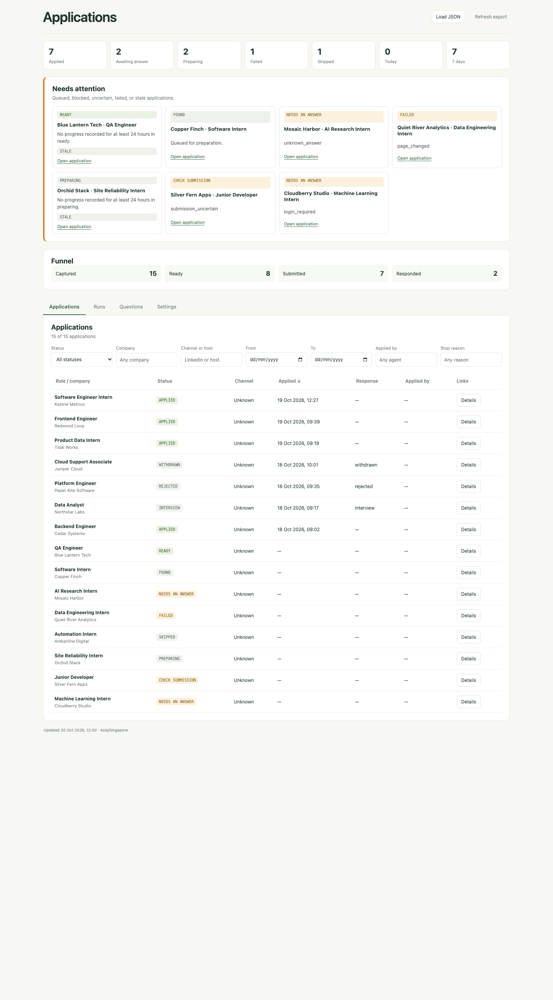
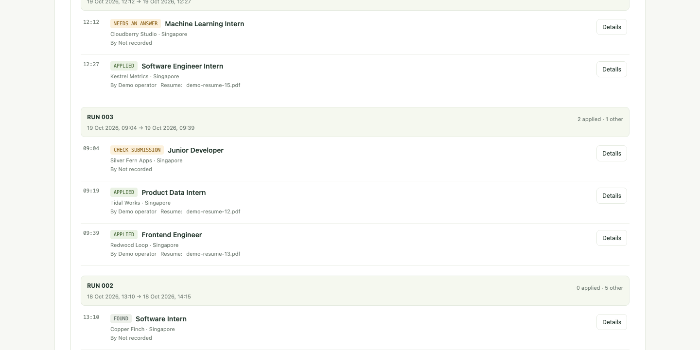
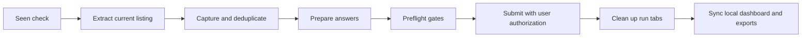

<p align="center"></p>

<p align="center"></p>

**applyd** is a local-first job application assistant that captures listings, prepares answers from your private answer bank, and records confirmed outcomes.





## Quickstart

Requirements: Python 3.11 or newer on macOS or Linux. The runtime uses Python's standard library, JSON files, and static HTML/CSS/JavaScript; no package installation, account, or browser login is needed to view the synthetic demo. See [platform notes and setup details](docs/setup.md).

1. **Initialize a new private workspace.** Use a path that does not exist or is empty. `init` refuses a nonempty path and never replaces existing files.

   ```sh
   export APPLYD_WORKSPACE="$HOME/.local/share/applyd-workspace"
   python3 scripts/workspace.py --workspace "$APPLYD_WORKSPACE" init
   ```

2. **Edit the settings.** Before using the agent, set `mode` to `"dry_run"` in the private `settings.json`. Keep this workspace outside the code checkout; add your own private profile and resume data only when you are ready to configure them.

   ```sh
   "${EDITOR:-vi}" "$APPLYD_WORKSPACE/settings.json"
   ```

3. **Run the skill or open the synthetic demo dashboard.** The demo uses fictional records in a separate temporary destination. It does not read the workspace, visit job sites, or need browser credentials. The generated dashboard opens directly from disk.

   ```sh
   DEMO_ROOT="$(mktemp -d "${TMPDIR:-/tmp}/applyd-demo.XXXXXX")"
   python3 scripts/demo.py --destination "$DEMO_ROOT"
   open "$DEMO_ROOT/dashboard/index.html"       # macOS
   # xdg-open "$DEMO_ROOT/dashboard/index.html"  # Linux desktop
   ```

   To use the included agent workflow in a compatible agent session, invoke `/apply-linkedin` from this checkout after you have configured your own private application data and browser session. Review [the workflow's safety steps](docs/safety.md) first. The synthetic demo above is complete without that setup.

## Architecture



The workflow checks known listings before opening them, extracts only the current listing, and records the full listing before preparation. Unknown material answers stay unresolved. Preflight checks the saved answers, resume, listing identity, and submission state immediately before an authorized submission. A submission is recorded only after confirmation is observed; an ambiguous result must be reconciled before retrying.

## Safety and privacy

- Submissions and outreach require the user's authorization. applyd does not scrape profiles or guess contact details. Outreach remains a draft for the user to send.
- The agent reads listing facts from the current job page. It does not browse profiles or company sites to fill gaps.
- Private workspaces, resumes, answer banks, application records, and exports belong outside the public checkout and are never committed. The repository denies files by default; never force-add private files.
- Unknown material facts stay unanswered until supplied. Eligibility, authorization to work, sponsorship, and employer consent are separate checks.
- Never treat a click as proof of submission. Save confirmation evidence and reconcile uncertain attempts before retrying.

## FAQ

### Can I see the demo without a resume or browser login?

Yes. The commands in step 3 generate a static dashboard from the checked-in fictional dataset. They do not read your private workspace or open a job site.

### Does setup install packages or start a server?

No. Python 3.11+ and its standard library generate the workspace and demo. The dashboard is static and works from a `file://` URL. Node.js is only needed for the optional JavaScript test suite. See [setup](docs/setup.md).

### Which platforms are supported?

macOS and Linux with POSIX `fcntl` support. Native Windows is not supported; use WSL. The optional screenshot-capture script needs an existing Chrome/Chromium executable and macOS `sips`; screenshot capture is not needed to generate or view the demo.

### Which agent skills are included?

The repository includes `/apply-linkedin`, `/answer-questions`, `/cleanup-run`, `/gmail-sync` and `/outreach`. The browser and draft-only mail adapters come from the authorized agent runtime; missing adapters return typed handoffs. Read-only mail sync accepts supplied local exports. See [lean workflows](docs/lean-workflows.md), [mail setup](docs/gmail-sync.md) and [bounded scheduled runs](docs/schedule.md).

## Project

- [Verification and runtime limits](docs/release.md)
- [Contributing](CONTRIBUTING.md)
- [Master plan](master-plan.md)
- [Roadmap](https://github.com/users/Collaboration95/projects/17)
- [License](LICENSE)
